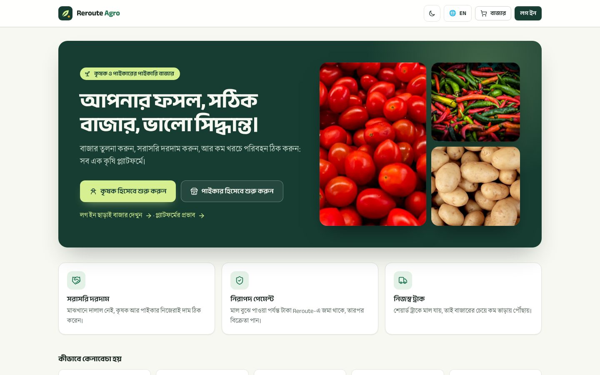
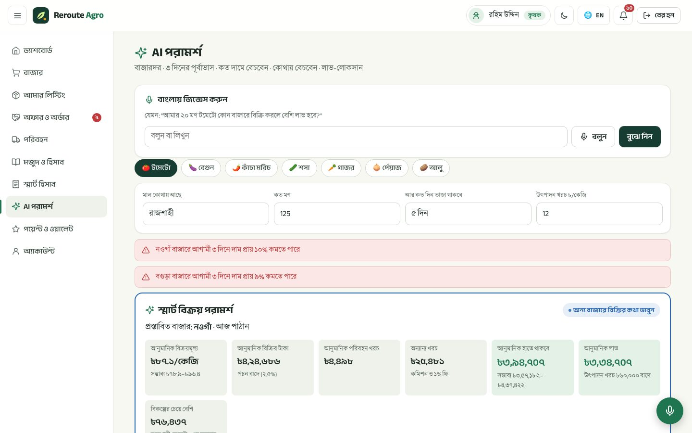
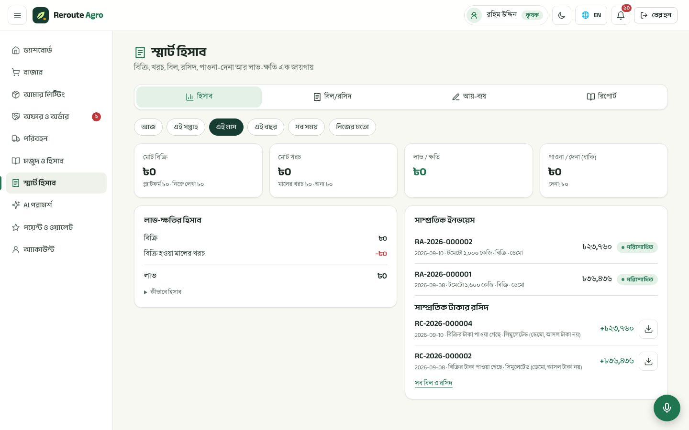
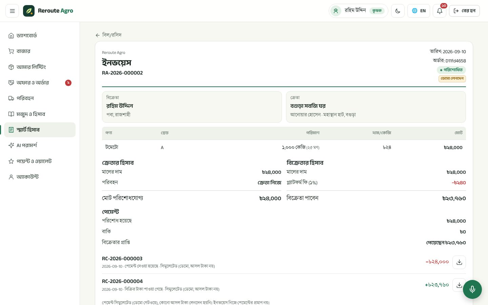
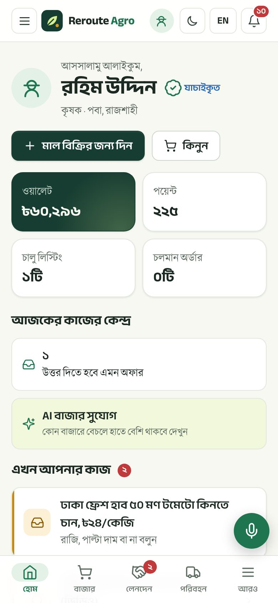
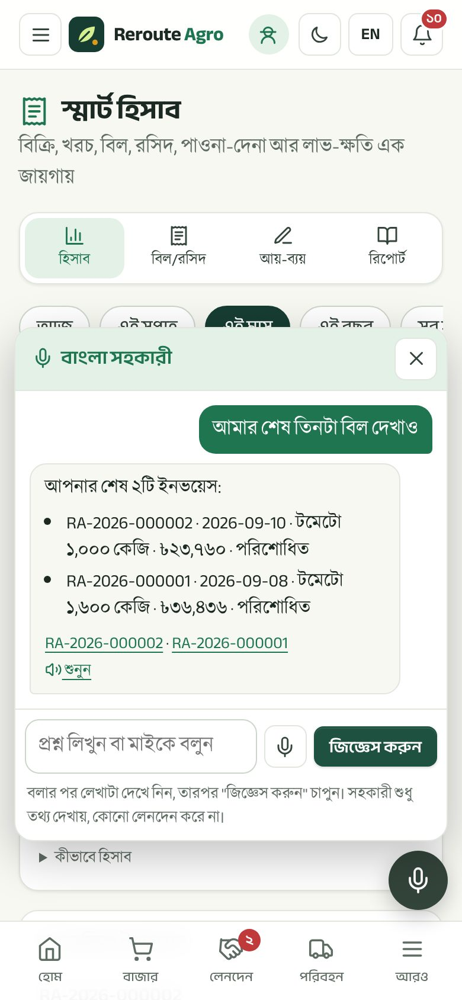
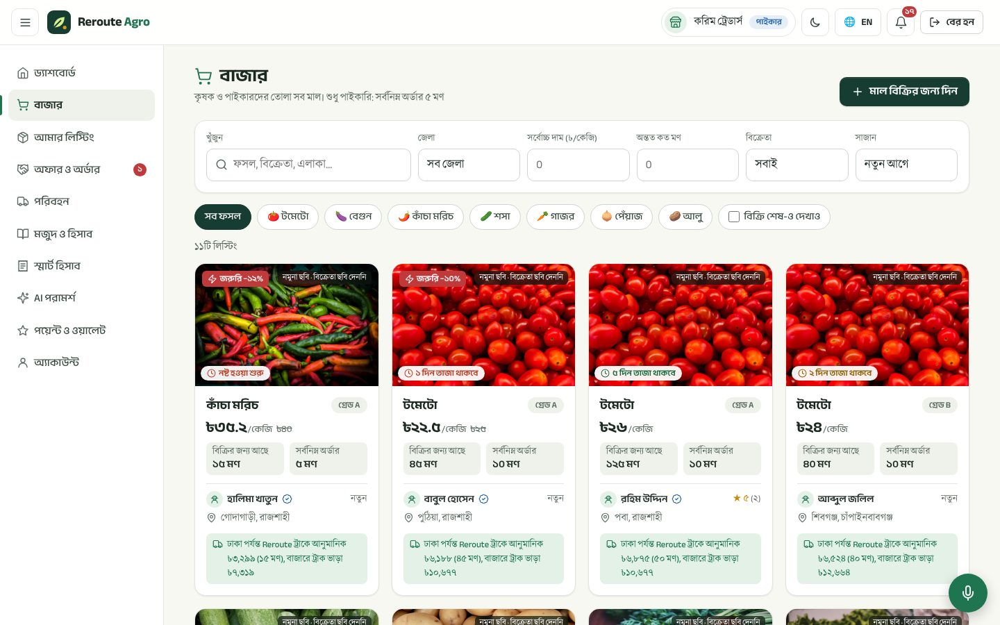
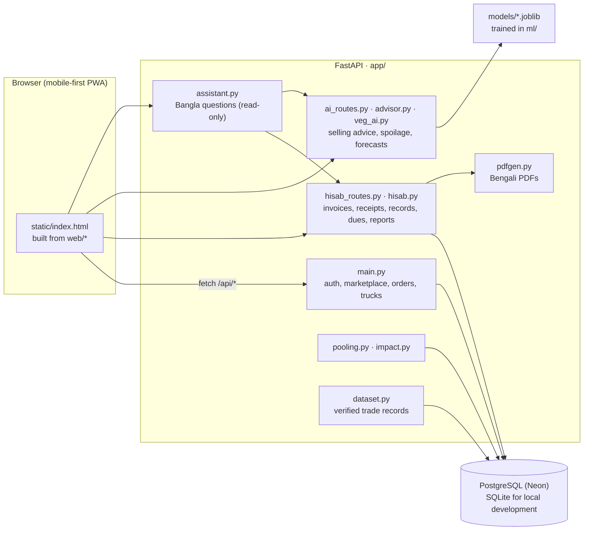

<div align="center">


# Reroute Agro

**আপনার ফসল, সঠিক বাজার, ভালো সিদ্ধান্ত।**<br>
A Bangla-first wholesale marketplace that connects farmers and paikars (wholesale buyers) in Bangladesh, with
AI-assisted selling decisions, shared truck transport and built-in bookkeeping.

[Live prototype](https://reroute-agro-k0of.onrender.com) · [Demo script](HACKATHON_DEMO.md) · [Deployment guide](DEPLOYMENT_GUIDE.md) · [Changelog](CHANGELOG.md)


</div>

> **Prototype notice.** Payments are simulated (no real money moves), the sign-up code is shown on screen
> because no SMS gateway is connected, and daily vegetable prices are simulated. Every such screen is labelled
> in the app. Built for **Hack for Humanity**.

<p align="center">
  
  
</p>
<p align="center">
  
  
</p>
<p align="center">
  
  
  
</p>

---

## Contents
- [The problem](#the-problem)
- [Features](#features)
- [Try the demo](#try-the-demo)
- [Architecture](#architecture)
- [Getting started](#getting-started)
- [Testing](#testing)
- [Deployment](#deployment)
- [Data and AI](#data-and-ai)
- [Security and privacy](#security-and-privacy)
- [Project structure](#project-structure)
- [Roadmap](#roadmap)
- [Documentation](#documentation)

## The problem
A large share of Bangladesh's fruit and vegetables is lost between harvest and sale. In season, farmers bring
their crop to the same nearby haat on the same day, prices collapse, while a market a few hours away still pays
more. Farmers do not know who will buy or which market leaves them the most money after transport and spoilage;
paikars do not know who has fresh stock; and trucks are booked one load at a time.

Reroute Agro brings the three decisions — **whom to sell to, where to sell, and how to move the crop** — into one
mobile-first app in Bangla, and keeps the farmer's accounts at the same time.

## Features

### Marketplace and negotiation
- Listings with photos, grade, quantity, minimum order and harvest date; search and filters.
- Offers, counter-offers and acceptance with a timeline of every step; video or in-person inspection requests.
- Escrow-style simulated payment (bKash, Nagad, card, wallet): money is released to the seller only after the
  buyer confirms receipt. Unpaid orders are cancelled automatically and the stock returns to the market.
- Platform fee 1 % of the sale (min ৳10, max ৳500), charged to the seller only.

### Reroute Trucks
- Own fleet (1.5 t pickup, 3.5 t mini truck, 7 t truck) booked with an order or separately.
- Booking flow: requested → confirmed → pickup scheduled → in transit → delivered, with notifications.
- Transport cost split negotiated between buyer and seller before payment.
- **Truck pooling:** bookings on the same route and day share a truck; each party pays its weight share, and the
  saving versus a standalone trip is shown.

### AI decision support
- **Smart Selling Advisor:** for each market, the expected price, revenue, transport, other costs and *net
  proceeds* for sending today, tomorrow or later; a clear decision (sell now / another market / wait /
  insufficient evidence) with the reasons and the risks.
- **Spoilage risk** (low / medium / high) from shelf life, days since harvest and temperature.
- **Ask in Bangla:** type or speak *"আমার ২০ মণ টমেটো কোন বাজারে বিক্রি করলে বেশি লাভ হবে?"*; the app shows
  what it understood and asks for anything missing before giving advice.

### Smart Hisab — bookkeeping (স্মার্ট হিসাব)
- **Overview:** sales, costs, profit/loss and receivables/payables for any period.
- **Bills & receipts:** invoices issued automatically when an order's terms are final (`RA-2026-000001`),
  receipts for every payment (`RC-…`); view, print, share or download as PDF with correct Bengali text.
  An invoice is never treated as proof of payment.
- **Income & expenses:** outside sales, crop purchases and cost categories, labelled *user-reported*, with
  duplicate warnings; records are voided with a reason, never deleted; optional receipt photo.
- **Receivables & payables** with due dates and partial payments; **reports** by day, week, month and product
  as CSV or PDF.
- Profit is shown only when all costs are known; otherwise the app says
  *লাভের হিসাব সম্পূর্ণ নয় — কিছু খরচের তথ্য পাওয়া যায়নি।*

### Bangla assistant
A floating microphone button on farmer and paikar pages answers questions such as *"আমার কত টাকা পাওনা আছে?"*,
*"এই মাসে আমার লাভ কত?"* or *"আমার শেষ তিনটা বিল দেখাও"* from the user's own records. It is read-only and never
makes a payment or an order.

### Also included
Rewards points and cashback with anti-abuse rules, Reroute Plus membership for paikars, an impact dashboard with
demo and registered data kept separate, an operations panel (bookings, fleet, verification, pooling), English
interface, light/dark theme, and an installable PWA with an offline page.

## Try the demo
Open the [live prototype](https://reroute-agro-k0of.onrender.com) (the free server may take up to a minute to
wake up) and choose a demo account on the login page. All people and businesses in the demo data are fictional.

| Account | Role | What to try |
|---|---|---|
| রহিম উদ্দিন | Farmer | answer an offer, AI advisor, Smart Hisab, Bangla assistant |
| করিম ট্রেডার্স | Paikar | accept a counter-offer and pay |
| বগুড়া সবজি ঘর | Paikar | confirm receipt of goods in transit |
| Operations (`01300000000`) | Admin | password login only (`DEMO_ADMIN_PASSWORD`); bookings, fleet, pooling, impact |

Simulated payment PIN: **12345** (any other PIN shows a failed payment). A new account can be created with the
on-screen prototype code. A step-by-step judging script is in [HACKATHON_DEMO.md](HACKATHON_DEMO.md).

## Architecture



| Layer | Technology |
|---|---|
| Frontend | Vanilla JavaScript, HTML and CSS in `web/`, concatenated into one page by `build.py`; no framework, no build toolchain |
| Backend | Python 3.12, FastAPI, Pydantic, Uvicorn |
| Database | PostgreSQL on Neon in production; SQLite for local development; versioned additive migrations |
| Machine learning | pandas, NumPy, scikit-learn gradient boosting, joblib |
| Documents | fpdf2 with HarfBuzz text shaping and Noto Sans Bengali |
| Hosting | Render (web service) + Neon (database) |

## Getting started

Requirements: Python 3.12 or newer.

```bash
git clone <this repository>
cd reroute-agro
python -m venv .venv && source .venv/bin/activate      # Windows: .venv\Scripts\activate
pip install -r requirements.txt -r requirements-dev.txt
python build.py                                         # builds static/index.html from web/*

APP_ENV=development ENABLE_DEMO_MODE=true DEMO_ADMIN_PASSWORD=admin-demo-pass-1 \
  uvicorn app.main:app --reload
```

Open http://127.0.0.1:8000. Without `DATABASE_URL` the app uses a local SQLite file and loads the demo data on
first start. Interactive API documentation is at `/docs`. Run `python build.py` again after editing anything in
`web/`.

All settings are described in [.env.example](.env.example). The most important ones:

| Variable | Purpose |
|---|---|
| `APP_ENV` | `production`, `demo` or `development` (defaults to `production` on Render) |
| `DATABASE_URL` | PostgreSQL connection string; required outside development |
| `SECRET_KEY` | 32+ random characters; required outside development |
| `ENABLE_DEMO_MODE` | demo accounts and on-screen sign-up code (default `true`) |
| `DEMO_ADMIN_PASSWORD` | password for the demo operations account (10+ characters) |

Useful commands:

```bash
python -m app.manage status                 # environment, migrations, account counts
python -m app.manage create-admin --phone 01XXXXXXXXX --name "Operations"
python -m ml.vegsim && python -m ml.train_veg   # rebuild the simulated vegetable data and model
python -m ml.train                          # retrain the monthly price model
```

## Testing

```bash
pytest -q                                                    # SQLite
TEST_DATABASE_URL=postgresql://…/scratch_db pytest -q        # PostgreSQL (the database is wiped!)
node tests/e2e/smoke.mjs http://localhost:8000 <admin password>   # browser journey (Playwright)
```

150 backend tests cover security, sign-up codes, concurrent payments and orders, Smart Hisab accounting,
the trade dataset, the assistant and database migrations. They pass on both SQLite and PostgreSQL (one test per
database applies only to the other). The browser test walks a full trade from listing to invoice and assistant
answer. Results and what is not yet verified: [TEST_REPORT.md](TEST_REPORT.md).

## Deployment
The app runs as a single Render web service with a Neon PostgreSQL database (`render.yaml`):

- Build: `pip install -r requirements.txt && python build.py`
- Start: `uvicorn app.main:app --host 0.0.0.0 --port $PORT`
- Health check: `/api/health`

Database migrations run automatically on start-up and only ever add tables and columns. Production never seeds
or resets data. Back up Neon before upgrading. Full steps, a separate demo deployment and rollback:
[DEPLOYMENT_GUIDE.md](DEPLOYMENT_GUIDE.md) and [DATABASE_MIGRATIONS.md](DATABASE_MIGRATIONS.md).

## Data and AI
We label every number by where it comes from.

| Source | Used for | Status |
|---|---|---|
| *Food Commodity Price (OHLC) Dataset of Bangladesh* — 76 markets, 2007–2025 | monthly price model | real data; on unseen 2023–2025 data the model predicts the direction of change correctly **70.8 %** of the time, mean error 1.73 % (naive 1.77 %) |
| `data/simulated/veg_prices_bd_sim.csv` — 6 markets × 7 vegetables, daily | 1–3 day vegetable forecasts and the selling advisor | **simulated** (the dataset has no vegetables); next-day error 6.5 % vs 8.0 % naive. A pilot would use Department of Agricultural Marketing prices |
| Completed trades on the platform | `trade_records` dataset | classified as real, demo, user-reported or simulated; only verified real trades are eligible for training, exported without personal data. Models are never retrained automatically |

Advice is decision support, not a guarantee; the advisor says *insufficient evidence* rather than guess.

## Security and privacy
- Server-side sessions, hashed passwords and sign-up codes, rate limits on login and sign-up.
- The operations account always needs a password; one-click login exists only for demo farmer and paikar accounts.
- Every write runs in one database transaction; double payments, overselling and negative wallets are prevented
  and tested under concurrency.
- Users see only their own invoices, receipts, records and money; phone numbers are shared only between the two
  parties of a paid order.
- Security headers, upload validation, request size limits, no secrets in the repository.

Details and known limitations: [SECURITY_REVIEW.md](SECURITY_REVIEW.md).

## Project structure
```
app/            FastAPI application (routes, services, accounting, AI, PDFs, migrations)
web/            frontend source, built into static/index.html by build.py
static/         built page, icons, PWA manifest and service worker
ml/             model training and the vegetable price simulator
models/         trained models and their metrics
data/           raw price data and the labelled simulated dataset
tests/          pytest suite and the Playwright end-to-end test
docs/           GitHub Pages showcase and screenshots
```

## Roadmap
- Real SMS verification and a licensed payment gateway (bKash / Nagad).
- Daily vegetable prices from the Department of Agricultural Marketing to replace the simulated data.
- GPS truck tracking and more districts and crops.
- Voice calls (IVR) in Bangla for farmers without smartphones.
- Retraining on verified first-party trade data, with human review before deployment.

## Documentation
| Document | Contents |
|---|---|
| [HACKATHON_DEMO.md](HACKATHON_DEMO.md) | 3-minute demo script and fallback plan |
| [DEPLOYMENT_GUIDE.md](DEPLOYMENT_GUIDE.md) | Render and Neon setup, environment variables, upgrade checks |
| [DATABASE_MIGRATIONS.md](DATABASE_MIGRATIONS.md) | migration list, accounting rules, rollback |
| [SECURITY_REVIEW.md](SECURITY_REVIEW.md) | threat review, fixes and remaining risks |
| [TEST_REPORT.md](TEST_REPORT.md) | what was tested, results, what still needs live verification |
| [PROJECT_AUDIT.md](PROJECT_AUDIT.md) · [IMPLEMENTATION_PLAN.md](IMPLEMENTATION_PLAN.md) | audit findings and work plan |
| [CHANGELOG.md](CHANGELOG.md) | release history |

<div align="center">
<sub>Reroute Agro · Social Catalyst · Built for Hack for Humanity</sub>
</div>
